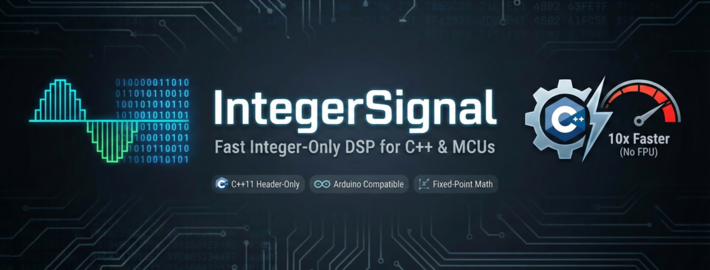

# 

`A toolkit for doing Digital Signal Processing on chips that are bad at math.`

Header-only C++ library for fast, deterministic, integer-only signal processing and math utilities for microcontrollers. No floating point required.

- Core embedded utilities for constrained targets: lightweight integer math, traits, bit/byte helpers, conversions, mixing, integer square root
- Fixed-point Fraction [-1; 1] and Scale [1/N; N] primitives as first-class DSP features
- Composable Filters and Curves (EMA/DEMA/LowPass, Power/SquareRoot/Clamp...)
- Color models (RGB8 / RGB10 / Fraction 15:15:15) with HSV and Oklch conversion and interpolation helpers
- Trigonometry: integer sine, cosine, and tangent with selectable 64- or 256-entry lookup tables for different memory trade-offs

## Why IntegerSignal?

- Up to ~10× faster on MCUs without floating point
- Efficient bitwise/branchless code paths due to template specialization
- No external dependencies
- Requires only C++11 or later

## Key features

#### Fixed-point Fraction scalars (0..1 and −1..1)
- Unsigned: UQ0.7, UQ0.15, UQ0.31
- Signed: Q0.6, Q0.14, Q0.30
- Typed constants for 1.0 and −1.0
- Operations: multiply by a fractional scalar, interpolate with a fractional scalar, compute scalars from numerator/denominator with clamping

#### Fixed-point Scale factors (values below and above 1.0)
- Unsigned and signed 8-bit, 16-bit, and 32-bit formats
- Operations: multiply by a scale factor, compute scale factors from numerator/denominator
- Compile-time and runtime implementations are available for fixed-point operations

#### Type traits and compile-time utilities
- Integer limits, range checks, and promotion to wider types
- Signedness detection and signed/unsigned type conversion
- Type comparisons, conditional types, and SFINAE helpers
- Trivial-copy and constant-evaluation detection, with compiler-dependent support and fallbacks

These C++11-compatible utilities provide alternatives to selected standard-library traits without requiring `<type_traits>`.

#### Additional modules
- Filters: EMA, DEMA, LowPass, and helpers (composable, template-based)
- Curves: Power, Root (square root), Limit/Clamp, ScaleDown, Signed, Strength
- Color models: RGB8 (8 bits per channel), RGB10 (10 bits per channel), Fraction 15:15:15 for high-precision intermediate math; HSV and Oklch conversion; integer-precise interpolation
- Trigonometry: integer implementations of sine, cosine, and tangent for modular fixed-point angles, using configurable lookup-table sizes

## Quick start

Top-level includes (only headers directly in `src/`):
```cpp
#include <IntegerSignal.h>        // Umbrella header: Base, FixedPoint, Filters, Curves, Colors
#include <IntegerTrigonometry.h>  // Trigonometry angle types and constants
#include <IntegerTrigonometry8.h> // 8-bit sine and tangent implementations
#include <IntegerTrigonometry16.h>// 16- and 32-bit sine and tangent implementations
```

The trigonometry lookup-table size can be selected as 64 or 256 entries with `INTEGER_TRIGONOMETRY_LUT` before including the trigonometry header. The default is 256 entries.

### Fractions and scales (minimal usage)

```cpp
#include <IntegerSignal.h>
using namespace IntegerSignal;

// Fraction (unsigned 0..1): compute 3/4 and apply
auto s = FixedPoint::ScalarFraction::GetScalarU16(3, 4);
uint16_t scaled = FixedPoint::ScalarFraction::Fraction<uint16_t>(s, 400); // -> 300

// Interpolate between 100 and 500 at 3/4
uint16_t y = FixedPoint::ScalarFraction::Interpolate<uint16_t>(s, 100, 500); // -> 400

// Scale factor: map 0..1023 to 0..255
auto k = FixedPoint::FactorScale::GetFactor16(255, 1023);
uint16_t pwm = FixedPoint::FactorScale::Scale<uint16_t>(k, /*adc*/ 512); // ≈ 128

// Signed scale factor: multiply by -2
auto signedScale = FixedPoint::FactorScale::GetFactorS16(-2, 1);
int16_t inverted = FixedPoint::FactorScale::Scale<int16_t>(signedScale, 100); // -> -200
```


## Directory structure

- `src/FixedPoint/` — Fraction scalars and signed/unsigned Scale factors (plus Q-format helpers)
- `src/Base/` — core embedded utilities (traits, operations, mix/interpolate, convert, bit/byte helpers, integer square root)
- `src/Filter/` — EMA, DEMA, LowPass, and helpers
- `src/Curve/` — Power, Root, Limit/Clamp, ScaleDown, etc.
- `src/Color/` — RGB8, RGB10, Fraction16, HSV, and Oklch
- `src/Trigonometry/` — integer trigonometry helpers and lookup tables
- `Examples/` — Arduino sketches

## Platform support

IntegerSignal is written in C++11 and supports a range of embedded and desktop targets, including AVR, ARM, RISC-V, and Xtensa. Architecture-specific optimizations are used where available; portable implementations are provided for other targets.
